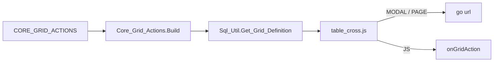

^ CMS · dynamic grid · arxitektura v3
# Grid tugmalari va ruxsatlar

Grid tugmasi hech qanday raqamli ID ga tayanmaydi. U `GRID_CODE`, o'z `ACTION_CODE` i va SM `PROCESS_CODE` bilan aniqlanadi. Bu uchala satr test va production da bir xil, shuning uchun bitta seed fayli ikkala bazada ham bir xil natija beradi.

> v3 sabab: `MENU_ID` va `BUTTON_ID` production va test bazalarida farq qiladi, v2 esa aynan shularga bog'langan edi.

## Qoida: konfiguratsiyada faqat satr kalitlar

Raqamli ID lar (`MENU_ID`, `BUTTON_ID`, `GRID_ID`, `FIELD_ORDER`) har bazada o'zicha. Kod va seed fayllar ularni hech qachon yozmaydi.

:::cards
### Grid
`GRID_CODE = 'COM_TARIFFS'`
`CORE_GRIDS_U1` unique, NOT NULL. FK shunga ulanadi, `GRID_ID` ga emas.
### Amal
`ACTION_CODE = 'EDIT'`
Grid ichida noyob, dasturchi beradi. Kalit: `(GRID_CODE, ACTION_CODE)`.
### Ruxsat
`PROCESS_CODE = 'EDIT_TARIFF'`
`SM_R_PROCESSES` PK. Server guard aynan shu kod bo'yicha tekshiradi.
### Yorliq va maydon
`LABEL_MLL_CODE, STATE_FIELD = 'STATE'`
MLT kodi va `FIELD_NAME` satr. URL dagi joylar ham `{FIELD_NAME}` ko'rinishida.
:::

## ER diagramma

[[+YANGI]] faqat `CORE_GRID_ACTIONS` · [[BOR]] qolganlari tegilmaydi

{{er}}

> `CORE_GRID_ACTIONS` menyu jadvallariga to'g'ridan-to'g'ri ulanmaydi. Ular bilan uchrashish nuqtasi `PROCESS_CODE`.

### `CORE_GRID_ACTIONS` ustunlari

{{columns CORE_GRID_ACTIONS}}

## Tugma qachon faol bo'ladi

```
door     = case when process_type = 'GET' then 'MODEL' else 'EXECUTE' end
granted  = PROCESS_CODE is null  OR  Core_Access.Decide(PROCESS_CODE, door) = 'ALLOW'
enabled  = granted AND state_ok
```

| Tekshiruv | Qayerda | Qachon |
|---|---|---|
| Grant | PL/SQL, `Core_Grid_Actions.Build` | Grid yuklanganda, bir marta |
| SM holati | Brauzer, `table_cross.js` | Har qator chizilganda |

## Gridgacha yo'l



## v2 dan v3 ga nima o'zgardi

| Mavzu | v2 | v3 |
|---|---|---|
| Grid ga havola | [[-GRID_ID]] | [[+GRID_CODE (unique)]] |
| Ruxsat birligi | Aniq tugma | Process |

## Bazada topilgan, avval tuzatiladigan narsalar

:::stats
### 21 | Server tekshirmaydigan tugmalar
`PROCESS_CODE` bo'sh, `ACTION_CODE` esa SM process.
### 39 | O'tishsiz SM processlar
`SM_R_TRANZITIONS` da qatori yo'q.
:::

## Joriy etish tartibi

1. **Ma'lumotni tuzatish** (production, alohida ruxsat bilan): 21 ta tugmada `PROCESS_CODE := ACTION_CODE`.
2. **DDL**: `CORE_GRID_ACTIONS`, FK `GRID_CODE` → `CORE_GRIDS_U1`.

## Hal qilinishi kerak bo'lgan savollar

- Process darajasidagi ruxsat yetarlimi?
- `GRID_CODE` ni o'zgartirish taqiqlanadimi?

## Bog'lanishlar

{{relationships}}
